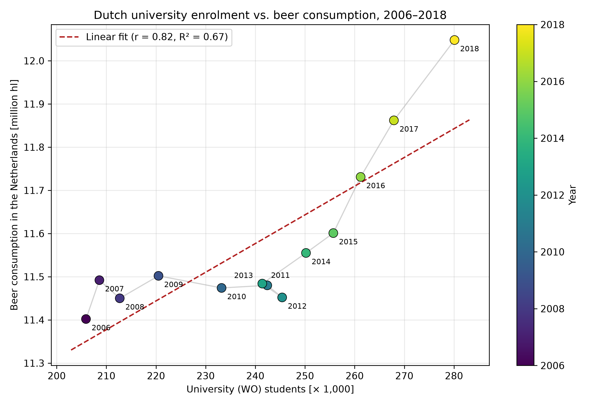

16983246

Paper's titles:

- Fantastic yeasts and where to find them: the hidden diversity of dimorphic fungal pathogens
- An analysis of the forces required to drag sheep over various surfaces
- The neurocognitive effects of alcohol on adolescents and college students

Graph:

> The data spreads across years 2006 to 2018 which represents the correlation between the number of university students in the Netherlands and beer consumption. The number of students grew steadily from about 206,000 to 280,000; beer consumption also increased, but slower, from 11.4 to 12.0 million hectolitres. From 2006 to 2013, beer consumption stayed roughly flat even though numbers of students kept rising. From 2014, both numbers went up together, with beer consumption rising faster in the last 3 years. The data seems to be correlated, but that does not prove that more students cause more beer drinking, since both may simply be growing over time for other reasons.
